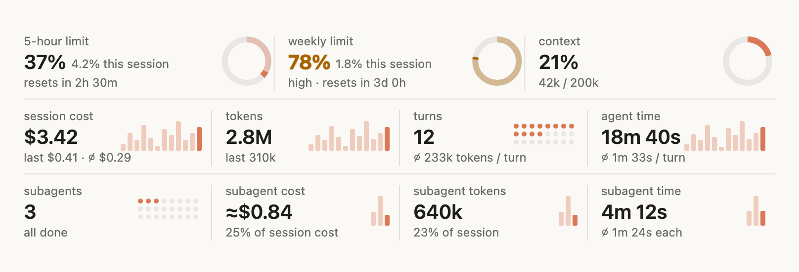
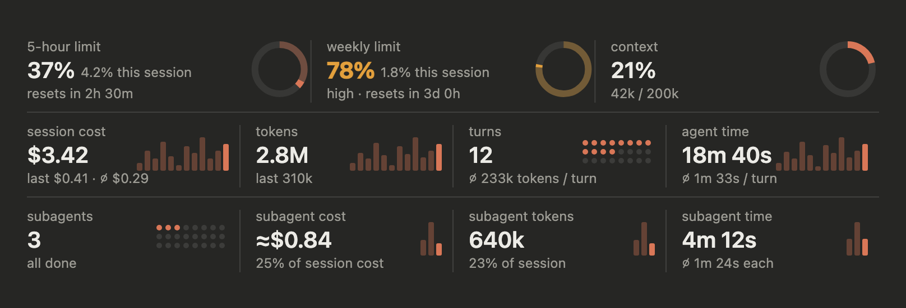

# deskstats

Usage stats for Claude desktop, in a band above the prompt: how close you are to your rate limits, how full the context is, what the session has cost, and what its subagents did.

**Light mode**



**Dark mode**



The band follows your system's light or dark setting. It updates live while Claude works: tokens, cost, context and limits after each model request, and agent time every second.

## Install

In Claude Code 2.1.275 or later:

```
/plugin install deskstats --marketplace rosario-terranova-nearform/deskstats
```

## What the band shows

| Row | Cell | What it tells you |
| --- | --- | --- |
| Limits | **5-hour limit**, **weekly limit** | How much of each rate-limit window is used, how much of that this session added, and when the window resets. |
| | **spend limit** | Shown only when a gateway sets one. |
| | **context** | How full the context window is, in percent and tokens. |
| Work | **session cost** | What the session has cost, with the last turn's cost and the average per turn. |
| | **tokens** | Tokens used, with the last turn's. |
| | **turns** | How many turns the session has run, with the average tokens per turn. |
| | **agent time** | How long Claude spent working, with the average per turn, or how long the current turn has run while it runs. |
| Subagents | **subagents** | How many ran, and how many are still running. Shown once the first subagent starts. |
| | **subagent cost**, **tokens**, **time** | What the subagents took, as a share of the session. |

### Reading the graphics

- **Rings** fill with the share used. On a limit, the faint part is use from before this session and the solid part is what this session added.
- **Bars** show the last 12 turns (or subagents), the latest one solid.
- **Dots** count turns or subagents, one each, up to 24.
- **Colour and words together:** a value turns amber and says "high" from 75%, and turns red and says "very high" from 90%, so the warning never rests on colour alone.

When the window is narrow, a row wraps onto a second line rather than letting text run into a ring. The band also carries a full text alternative for screen readers.

## Subagent details

As soon as a subagent starts, a **Subagent details** button appears under the band. It opens a pane listing each subagent, newest first: what it was asked, which model ran it, the tools it called, its estimated cost, tokens and time, and the first line of its report. The top line splits the session's cost between the main agent and its subagents.

## How the numbers are estimated

- **Subagent cost** is estimated per request from token counts and a hand-copied list-price table in `hooks/prices.ts`. Update it when prices or models change. A subagent on a model the table does not know shows as "not priced" and is left out of the totals.
- **Session cost** counts from the last time the conversation was cleared.
- **"This session" on a limit** counts every point the window moved during this session's turns, so another session running at the same time inflates it.

## Development

The band is drawn by `hooks/svg.ts` from the figures `hooks/register.tsx` collects. Run the tests with:

```bash
claude plugin test .
```
